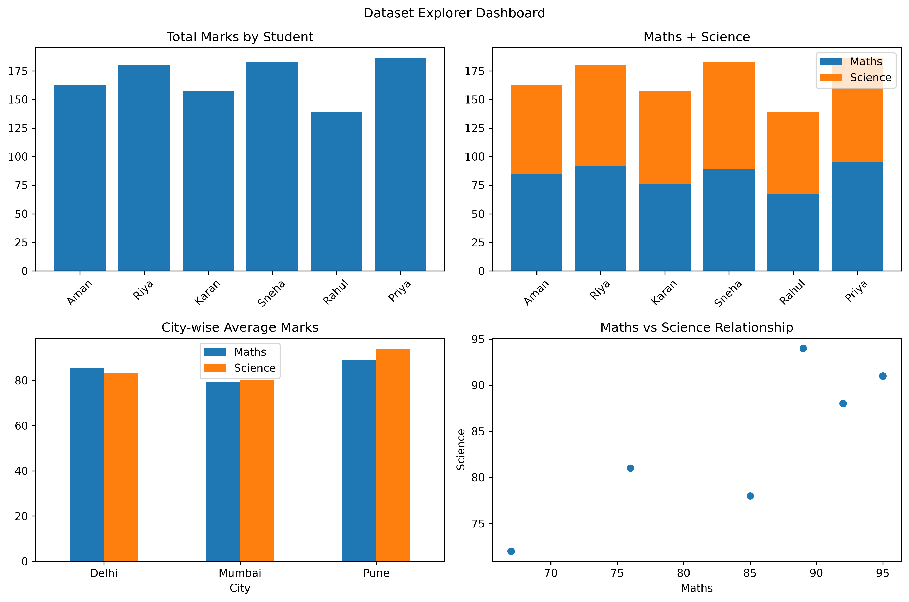

# Dataset Explorer 📊

A Python-based data analysis project that explores student performance using Pandas and visualizes insights using Matplotlib.

## 📌 Project Overview

Dataset Explorer analyzes student marks in Maths and Science. It explores student performance, compares subjects, calculates statistics, groups students by city, and creates visualizations to make the data easier to understand.

## ✨ Features

- Load and explore CSV datasets using Pandas
- Analyze missing values and duplicate records
- Calculate total and average marks
- Compare Maths and Science performance
- Analyze student performance by city
- Rank students and assign grades
- Identify top-performing students
- Create multiple data visualizations using Matplotlib
- Generate a dashboard containing four charts
- Export cleaned data and analysis summaries

## 🛠️ Technologies Used

- Python
- Pandas
- Matplotlib
- CSV

## 📁 Project Files

- `dataset.csv` — Original student dataset
- `dataset_explorer.py` — Main data analysis script
- `visualizations.py` — Data visualization script
- `dataset_dashboard.png` — Saved dashboard image
- `cleaned_dataset.csv` — Cleaned dataset output
- `city_summary.csv` — City-wise summary output
- `analysis_report.txt` — Generated analysis report

## ▶️ How to Run

1. Install Python.
2. Install the required libraries:

   ```bash
   python -m pip install pandas matplotlib
   ```

3. Run the main analysis:

   ```bash
   python dataset_explorer.py
   ```

4. Run the visualizations:

   ```bash
   python visualizations.py
   ```

## 📊 Dashboard

The project includes a dashboard combining four visualizations to explore student performance, subject marks, city-wise averages, and the relationship between Maths and Science marks.



## 🎯 Learning Outcomes

This project provides practical experience with data cleaning, exploratory data analysis, Pandas operations, data aggregation, and visualization using Matplotlib.

---

Created as a Python data analysis learning project.